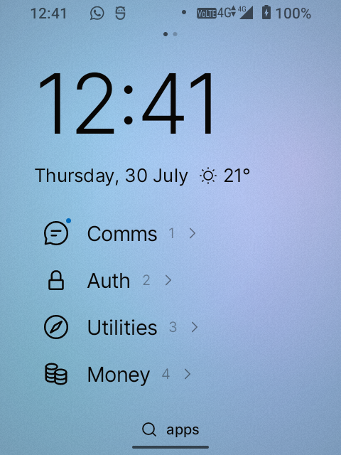
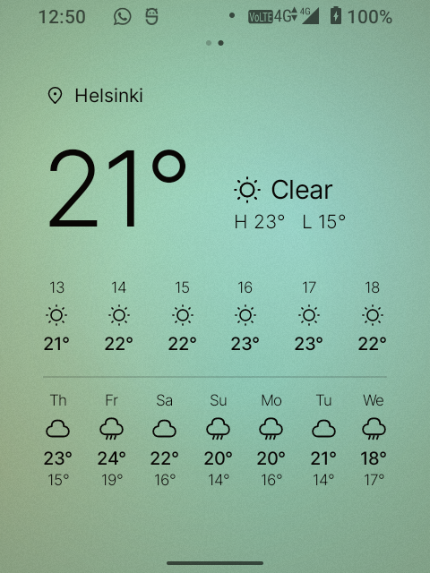
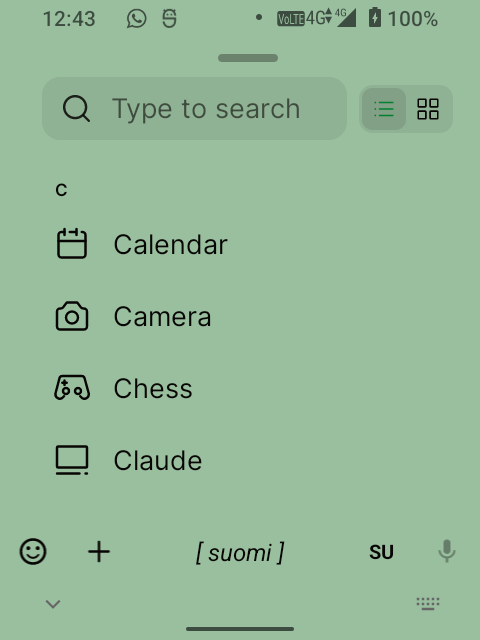
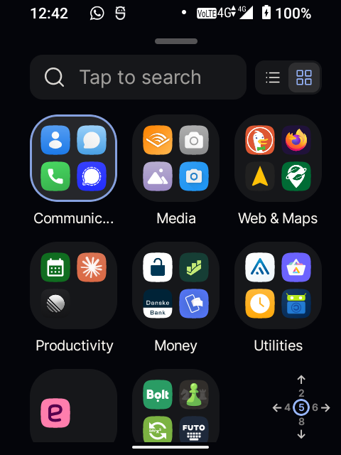
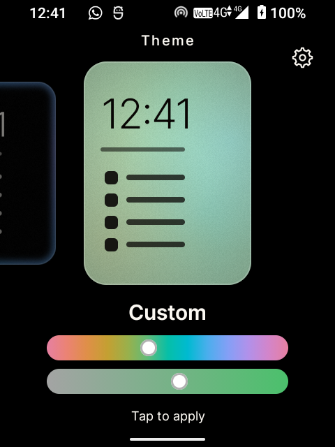

<p align="center">
  
</p>

# SideHome 🌅

**A calm, ambient home-screen launcher for the [Sidephone SP-01](https://sidephone.com) — a window onto your day, not a wall of apps.**

<p align="center">
  <a href="https://github.com/sponsors/oliverpalonkorp"></a>
  &nbsp;
  <a href="https://sidesuite.app/sidehome"></a>
  &nbsp;
  
</p>

<p align="center">
  One of three open-source apps for the SP-01 — see <a href="https://sidesuite.app">sidesuite.app</a>,
  or install all of them at once from the <a href="#install">SideSuite app pack</a>.
</p>

SideHome replaces the home screen on the [Sidephone SP-01](https://sidephone.com) — a de-Googled AOSP
feature phone with a swappable physical keypad. It's built to feel like *a window, not a UI*: you
glance at it, sense the time of day, tap the one thing you came for, and put the phone back down.

The soul of it is a **day-following ambient background** — soft, blurred colour that tracks the real
sun for your latitude, interpolated in OKLCH so the light drifts continuously through
dawn → day → dusk → night, never a stepped slideshow. Over that sky sits a short, left-aligned list of
favourites: no grid, no icon sea, no chrome.

> **In one sentence:** it turns the SP-01's home into a quiet, living page you read at a glance — and,
> if you'd rather never touch the screen, drives entirely from the phone's physical keys.

<p align="center">
  
  &nbsp;&nbsp;
  
</p>
<p align="center"><em>The home, and the weather a swipe to the right.</em></p>

---

## Contents

- [Why SideHome](#why-sidehome)
- [What it does](#what-it-does)
- [Themes](#themes)
- [Driving it by the keypad](#driving-it-by-the-keypad)
- [Install](#install)
- [First-time setup](#first-time-setup)
- [Privacy & permissions](#privacy--permissions)
- [Status](#status)
- [For developers](#for-developers)
- [License](#license)
- [Support](#support)
- [Credits](#credits)

---

## Why SideHome

The SP-01 is a lovely, deliberately-minimal phone: de-Googled, physical-keyed, small screen. A home
screen built for a slab of glass and an app store doesn't fit it — a grid of app icons is a wall to
push through every time you pick the phone up.

SideHome is the opposite. It shows the time, the day, a hint of the weather, and the few apps you
actually reach for — and otherwise gets out of the way. The background is alive with the real light
outside, so you sense the time of day at a glance, before you've even read the clock. And because the
SP-01 is a keypad phone, every part of it can be driven by the keys, no screen-tapping required.

---

## What it does

- **A day-following ambient sky.** The whole background is one continuous OKLCH colour field that
  tracks the sun for your location and drifts through the day. It's static between shifts (a calm
  launcher shouldn't burn battery repainting), so an idle home costs almost nothing.
- **A calm home page.** A large clock, the date with a **one-line weather glance**, and up to four
  favourites as a text-and-glyph list. Tap the clock to open the clock app.
- **Direct-manipulation editing — no edit mode.** Long-press a favourite to pick it up and place it;
  drop one onto another to make a folder; drag it off to remove. A full home is a question ("group, or
  replace?"), never a wall.
- **An app library that's a place, not a sheet.** Swipe up. Search with real predictive typing on any
  tile, or browse an A–Z list or grouped category bubbles — your choice, remembered.
- **Folders** that open in place, manage in place, and name themselves from what's inside.
- **A weather page.** Swipe right to a calm forecast — now, a smart change-line ("clearing by 11:00"),
  the next hours, and the week — for a place you type. *(Opt-in; see [Privacy](#privacy--permissions).)*
- **Notification dots.** An optional accent dot on apps with something unread, on the home, in the
  drawer, and on folders. *(Opt-in; see [Privacy](#privacy--permissions).)*
- **Full hardware key-navigation.** Drive every surface — favourites, the library, folders, menus —
  from the SP-01's physical keys, with no setup. See below.

<p align="center">
  
  &nbsp;&nbsp;
  
</p>
<p align="center"><em>The app library — search by predictive typing, or browse A–Z and by category.</em></p>

> **Search that actually knows your apps.** When you type in the library, SideHome hands the moment to
> its sibling keyboard **[SideType](https://github.com/side-suite/SideType)** with a private, trusted
> signal that says *"this field is an app search."* SideType then turns your launchable apps into a
> live prediction dictionary for that field alone — so on the SP-01's ambiguous multi-tap tiles, a
> press or two lands straight on brand names a normal word predictor would never guess: *Revolut*,
> *Aegis*, *Obtainium*. The bias is rebuilt on every focus and dropped the moment you leave the field,
> so your app names never bleed into ordinary typing anywhere else. It makes **search-to-launch a
> first-class way to navigate**, not a fallback — and it's the kind of thing only a launcher and a
> keyboard built as a suite can do. *(With any other keyboard the field just types normally.)*

---

## Themes

Long-press an empty patch of home → the home **zooms out** → swipe through the themes; tap one to
apply. Within taste, only the *palette* changes — text and accent colours stay auto-derived for
legibility, so there are no illegible combinations and no free colour pickers.

1. **Ambient** — the live day-following sky. The default.
2. **Full light** — a clean, bright near-white.
3. **Full dark** — a tinted charcoal that keeps a living texture, never a flat black.
4. **Edge** — a dark home with a small, intense colour rim glowing at the border.
5. **Custom** — pick your own **hue and saturation**; the engine derives lightness, ink and accent
   from it, so your colour breathes with the day and always stays readable.

<p align="center"></p>

---

## Driving it by the keypad

The SP-01 takes swappable keypad tiles, and SideHome navigates by them with **no profile setup** — the
tiles emit distinct keycodes, so one unified map drives whichever is fitted. It's tested on the **Compact
QWERTY**, **Sundial**, and **T9** tiles; **Classic Keypad** and **Mini Controller Keypad** support is
coming soon.

- **Numbers are direct-index.** On the T9 and Compact QWERTY tiles, the 1–9 markings launch the
  matching favourite (or pick a bubble) in a single press.
- **The Sundial ring is a D-pad.** Rock the ring to move a cursor, press the centre to select.
- **Back and Select per tile.** QWERTY uses its hardware Back and Enter; the Sundial uses its corners;
  on T9, **Back is `*` and Select is `#`** (the top Call/Home/End row belongs to the phone, so the
  launcher can't use it).
- **The Home key opens the app library** from a bare home, and steps back out of anything that's open.

Key-navigation ships on by default and can be turned off in Settings (so it never fights an external
key-mapper). Typing into a search field still leaves the navigation keys live, so you can always walk a
list and leave a field without reaching for the screen.

---

## Install

Two ways in. Both install the same signed app.

### On a Sidephone SP-01: the App Pack

The SP-01's **Library** can add extra sources, called app packs. From the SideSuite pack,
SideHome installs with **no "unknown sources" warning** and updates **on its own**. The
Library is a privileged system installer.

<p align="center"></p>

1. **Library → Settings → App Packs → +**, then scan the code above, or type in
   `https://fdroid.sidesuite.app/fdroid/repo`
2. Check the fingerprint on screen matches:

   ```
   61FD7A8F0D32925EE80C7F55A6690C2A02C2FC3CA9C678370BF623EAB29870A0
   ```

3. Install **SideHome** from the Library.

The pack also carries [SideType](https://github.com/side-suite/SideType) and
[SideCall](https://github.com/side-suite/SideCall). One scan gets you all three.

### Anywhere else: Releases

1. Grab the latest `app-release.apk` from
   [Releases](https://github.com/side-suite/SideHome/releases) (or build it yourself — see
   [For developers](#for-developers)).
2. Copy it to the phone and open it, or install over USB:
   ```
   adb install -r app-release.apk
   ```

For update notifications on this path, use
**[Obtainium](https://github.com/ImranR98/Obtainium)** and add this repo's URL.

### Then, either way

Press **Home** and choose **SideHome** as your default launcher.

It needs Android 12 (API 31) and is designed for the SP-01's 480×640 screen.

---

## First-time setup

There's almost nothing to set up — that's the point.

- **On first launch**, a one-time coach shows the swipes (up for apps, right for weather). It appears
  once and never again.
- **Weather (optional):** swipe right to the weather page and tap **"Set your location"** to type a
  city. Nothing is fetched until you do.
- **Notification dots (optional):** long-press empty home → the **gear** → **Notification dots** →
  grant access on Android's own page.

---

## Privacy & permissions

SideHome is a launcher, not a data funnel — no tracking, no ads, no accounts, nothing to sign into. It
declares exactly **two** permissions, each tied to a feature you opt into:

### `INTERNET` — for the weather, and only the weather

The weather page fetches from [Open-Meteo](https://open-meteo.com): two requests, on view, when the
forecast on screen is stale. That's the only thing SideHome ever puts on the network — no analytics, no
phone-home.

- **Nothing is fetched until you set a location.** Until you type a city, SideHome makes **zero**
  network calls. A phone that never sets a location never touches the network.
- **There is no location permission and never will be.** The place is *typed and geocoded*, not sensed
  — on a de-Googled phone the automatic options are dead or battery-hungry anyway, and a city-scale
  forecast doesn't need GPS.

*(`INTERNET` is a normal install-time Android permission, so it's granted at install and can't be
toggled at runtime — but the app only ever* uses *it after you've set a location.)*

### Notification access — optional, off by default

The **notification dots** feature needs Android's **Notification access** grant
(`BIND_NOTIFICATION_LISTENER_SERVICE`) — the only way a launcher can know an app has something unread
(the AOSP launcher takes the same path; there is no narrower API). A broad-sounding permission for a
small feature is exactly why it's **opt-in**, off until you turn it on, with no first-run nag.

While it's granted, SideHome asks one question of each notification — *does this count as a dot?* — and
keeps only a **set of package names** ("these apps have a dot") in memory. It counts a notification only
if it's **not ongoing** (media/VPN/foreground-service notices are ignored), **not a group summary** (so
a multi-thread app dots once), and **badge-eligible** (the channel's own `canShowBadge()` is honoured).

**The listener never:**

- **stores notifications** — no database, no log, no cache; not the text, title, sender, or a count;
- **transmits anything** — its only output is that in-memory set of package names, which never leaves
  the process and is never sent over the (weather-only) network;
- **reads content beyond the dot decision** — Android hands over the whole notification (it offers no
  filtered variant); SideHome reads the flags and channel, takes the package name, drops the rest;
- **listens when access isn't granted** — ungranted, the OS never even starts the service.

Turn it off by revoking the grant on the same Android page. There's deliberately **no separate switch
inside SideHome** — the system grant *is* the switch, so "off" means *access revoked, not listening*,
never "granted but promising not to look."

---

## Status

**v1.0.** Feature-complete and running on the SP-01, with 470+ unit tests over the pure logic (colour,
gestures, key-nav, drop rules). The left-hand **Past** pane ships disabled — Home is the left end — and
the **Future** pane is weather-only for now; journal, reminders, calendar and spotlight search are
parked for a later release.

---

## For developers

SideHome is native **Jetpack Compose** in **Kotlin** — a fresh `HOME` Activity, not a Launcher3 fork.
`minSdk 31` (Android 12), targeting the SP-01 (Helio A22, 480×640).

Build and install a debug APK onto a connected device (from the `android/` directory, with a JDK 17):

```
JAVA_HOME=/path/to/jdk-17 ./gradlew :app:installDebug
```

Run the unit tests (no device needed):

```
./gradlew :app:testDebugUnitTest
```

The interactive web prototype that tuned the ambient feel before the Compose build is still in
[`prototype/`](prototype/) (`open prototype/index.html`).

---

## License

SideHome is free software under the **GNU General Public License v3.0** — see [`LICENSE`](LICENSE).
You're free to use, study, share and modify it; derivatives stay open under the same license. It's the
same copyleft the sibling [SideCall](https://github.com/side-suite/SideCall) ships under.

---

## Support

SideHome is free software, built for one small phone by one person. There's no company behind it and
nothing to buy — if it's made your SP-01 nicer to live with, you can help keep it (and the rest of
SideSuite) going:

<p align="center">
  <a href="https://github.com/sponsors/oliverpalonkorp"></a>
</p>

Any amount is genuinely appreciated. Thank you. 💛

---

## Credits

- Built for the **[Sidephone SP-01](https://sidephone.com)**.
- Part of the **[SideSuite](https://github.com/side-suite)** family, alongside
  [SideType](https://github.com/side-suite/SideType) (predictive keyboard) and
  [SideCall](https://github.com/side-suite/SideCall) (call guard).
- Weather by [Open-Meteo](https://open-meteo.com); icons from the [Iconoir](https://iconoir.com) set
  (MIT License); the [Inter](https://rsms.me/inter/) typeface.
